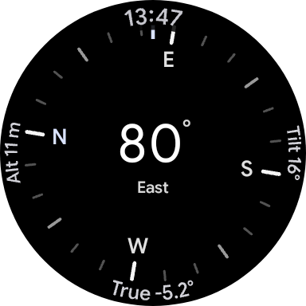
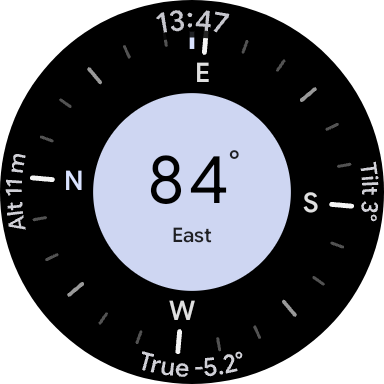
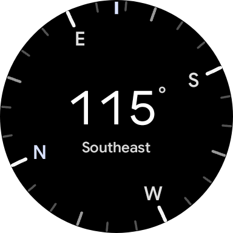
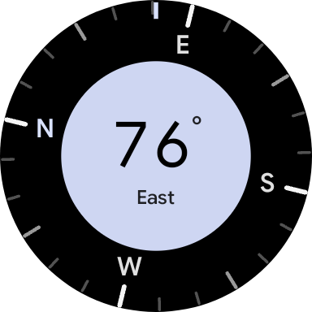
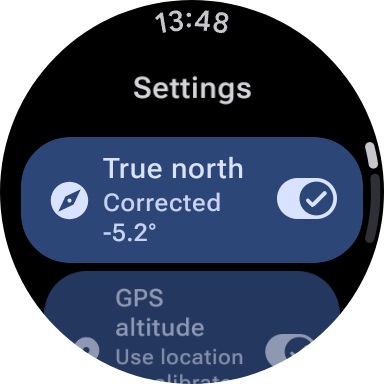
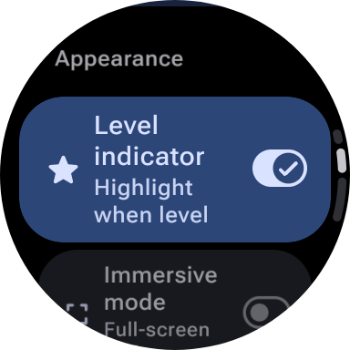
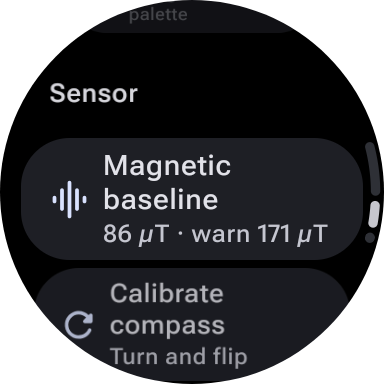
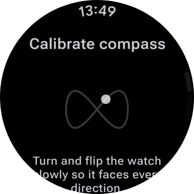
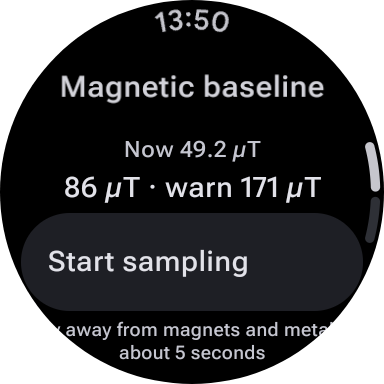

# Background
Google has never developed a dedicated compass app for the Pixel Watch series, despite the device having all the necessary sensors

Compass apps from other smartwatch manufacturers either aren't built for Wear OS or impose additional restrictions and checks that prevent them from working as expected on the Pixel Watch

Meanwhile, compass apps available on the Play Store are either stuck with outdated UI designs or locked behind a paywall

So, I decided to build my own Wear OS compass app, powered entirely by vibe coding

# Screenshots

<table align="center">
  <tr>
    <td align="center"></td>
    <td align="center"></td>
    <td align="center"></td>
  </tr>
  <tr>
    <td align="center"></td>
    <td align="center"></td>
    <td align="center"></td>
  </tr>
  <tr>
    <td align="center"></td>
    <td align="center"></td>
    <td align="center"></td>
  </tr>
</table>

# Compatibility
- Support any round-screen smartwatch running Wear OS 3+ (Android 11 / API 30)

# WARNING
All code in this project is generated by LLM and has not been reviewed by a human. If you have any concerns about its reliability or safety, please do not use this project

# License
This project is licensed under the [GNU General Public License v3.0](LICENSE). You are free to use, study, modify, and redistribute it, provided that any derivative work is released under the same license and its source code remains available to anyone who receives it

# Credits
- [Hanhanawa/BakaSU/tree/wear_manager](https://github.com/Hanhanawa/BakaSU/tree/wear_manager) UI Design Reference

